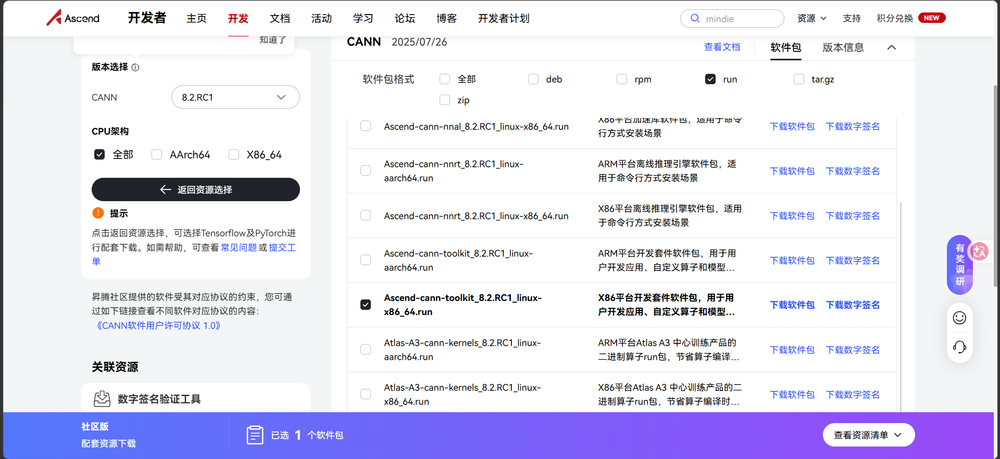

# YOLOv5 目标检测推理应用开发

本目录包含基于 CANN 推理引擎的 **YOLOv5 目标检测** 完整解决方案，包括 CLI/兼容 HTTP 服务、5001 回环二进制推理服务、OpenHarmony 实时摄像头应用，以及模型部署所需的脚本和配置文件。

---

## 目录结构

```
task3_yolov5/
├── server/                                    # 核心推理程序
│   ├── main.py                                # YOLOv5 CLI 推理主程序（支持 OM/ONNX 后端）
│   └── server.py                              # 兼容 HTTP 服务端（5000，仅供图片页）
│
├── scripts/                                   # 部署与运行脚本
│   ├── hdc_deploy_from_windows.ps1            # Windows 端：一键部署到 OpenHarmony 设备
│   └── run_on_device.sh                       # 设备端：一键运行推理
│
├── model/                                     # 预转换模型
│   └── yolov5s_ascend310b.om                  # YOLOv5s 的 OM 格式模型（Ascend 310B）
│
├── example_image/                             # 示例图片
│   ├── test.jpg                               # 测试输入图片
│   └── test_detected.jpg                      # 检测结果示例
│
├── requirements/                              # Python 依赖
│   ├── requirements-device.txt                # 设备端依赖（ais_bench、aclruntime、opencv 等）
│   └── requirements-pc-smoke.txt              # PC 端冒烟测试依赖（onnxruntime）
│
├── screenshots/                               # 文档截图
│   └── file-20260617162400895.png             # CANN toolkit 下载页面截图
│
├── yolov5_app/                                # OpenHarmony 图形应用（ArkTS）
│   ├── AppScope/                              # 应用级配置与资源
│   ├── build-profile.json5                    # 构建配置
│   └── entry/                                 # 主模块
│       ├── src/main/ets/
│       │   ├── entryability/EntryAbility.ets  # 应用入口 Ability
│       │   ├── model/ImageItem.ets            # 图片数据模型
│       │   ├── native/YoloNativeBridge.ets   # 只暴露 NAPI，不暴露服务协议
│       │   ├── rules/SceneRuleEngine.ets     # 三种场景的时序告警规则
│       │   └── pages/
│       │       ├── Index.ets                  # 主页面（图片选择与识别入口）
│       │       ├── LiveCamera.ets              # Preview + JPEG/YUV 实时检测
│       │       ├── Splash.ets                 # 启动页
│       │       └── ResultView.ets             # 识别结果展示页
│       └── src/main/resources/                # 应用资源（图标、字符串等）
│
└── README.md                                  # 本文档
```

---

## 文件功能说明

### server/ — 核心推理程序

| 文件 | 作用 |
|---|---|
| `main.py` | **YOLOv5 CLI 推理主程序**，支持两种后端：`ais_bench`（设备端 OM/NPU 推理）和 `onnxruntime`（PC 端 CPU 冒烟测试）。实现完整推理流程：letterbox 预处理 → BGR2RGB/归一化 → NPU 推理 → NMS 后处理 → 绘制检测框 → 保存结果（图片/txt/json）。默认支持 COCO 80 类，可通过 `--classes` 参数指定自定义类别文件。 |
| `server.py` | **兼容 HTTP 服务端**，基于 Python `http.server`，只监听回环地址 5000，供历史图片页使用；实时摄像头检测不经过它。 |

### scripts/ — 部署与运行脚本

| 文件 | 执行环境 | 作用 |
|---|---|---|
| `hdc_deploy_from_windows.ps1` | Windows | 通过 HDC 将 `main.py`、`requirements-device.txt`、`run_on_device.sh`、OM 模型、测试图片推送到设备 `/cann-install/yolov5_cli/` 目录，并设置可执行权限。支持 `-Model` 和 `-Image` 参数指定自定义模型和图片路径。 |
| `run_on_device.sh` | 设备端 | 一键运行推理脚本：自动加载 CANN 环境变量，调用 `main.py` 执行推理，支持通过环境变量 `MODEL`、`IMAGE`、`OUTPUT`、`DEVICE_ID` 等自定义参数。 |

### model/ — 预转换模型

| 文件 | 说明 |
|---|---|
| `yolov5s_ascend310b.om` | 由 YOLOv5s ONNX 模型通过 ATC 工具转换而来的 OM 格式模型，适配 Ascend 310B NPU。输入尺寸 1×3×640×640，FP16 精度。 |

### example_image/ — 示例图片

| 文件 | 说明 |
|---|---|
| `test.jpg` | 测试输入图片，用于验证推理流程 |
| `test_detected.jpg` | 检测结果示例，包含绘制的检测框和类别标签 |

### requirements/ — Python 依赖

| 文件 | 用途 | 主要依赖 |
|---|---|---|
| `requirements-device.txt` | 设备端推理 | numpy、opencv-python、pillow、ais-bench、aclruntime |
| `requirements-pc-smoke.txt` | PC 端冒烟测试 | numpy、opencv-python、onnxruntime（不使用 NPU） |

### yolov5_app/ — OpenHarmony 图形应用

| 文件 | 作用 |
|---|---|
| `EntryAbility.ets` | 应用入口 Ability，负责应用生命周期管理 |
| `Index.ets` | 主页面，提供图片选择和识别触发功能 |
| `Splash.ets` | 启动页，应用启动时显示 |
| `ResultView.ets` | 识别结果展示页，显示检测框和类别标签 |
| `ImageItem.ets` | 图片数据模型，定义图片路径和识别状态 |
| `native/YoloNativeBridge.ets` | ArkTS 只调用 `libyolo_napi.so`；NAPI 内部访问本机 127.0.0.1:5001 服务 |
| `pages/LiveCamera.ets` | Preview 与 VideoOutput + ImageReceiver + YUV420 并行路径；不支持 YUV 的设备自动回退 PhotoOutput/JPEG |
| `rules/SceneRuleEngine.ets` | 工作、安检、公共三种场景的连续帧/空间/冷却规则 |

### 5001 推理服务

`yolov5_app/tools/device/yolo_acl_service.py` 是独立 glibc/Python CANN 服务，固定监听
`127.0.0.1:5001`。NAPI 发送模型和 `uint8` NCHW 输入，服务端复用模型并执行 NMS，返回最多
100 个紧凑检测框。服务文件由系统镜像的 init 配置启动，模型和日志写入
`/data/yolov5_napi`；`run_yolo_acl_service.sh` 对图像内置的 Python、CANN 库、HDK 库和三个 NPU
设备节点做启动前检查，设备节点最多等待 30 秒，失败会在
`/data/yolov5_napi/yolo_acl_supervisor.log` 中记录精确缺件。该服务不再依赖
`/cann-install/task2_cann/03_set_cann_env.sh` 或人工安装的 Python。
首次启动的载荷安装日志位于 `/var/log/cann_runtime_install.log`，SHA-256 校验日志位于
`/var/log/cann_payload_verify.log`。

系统镜像仅携带 YOLO OM 运行所需的 CANN 8.2.RC1 runtime、PyACL、Python 3.10、
NumPy、`aclruntime` 和 `ais_bench`；编译器、NNAL、开发 stub 和 kernels/OPP 不进入镜像。
当前 YOLO OM 是 ATC 已编译的固定 `1×3×640×640` shape 图，服务不调用 aclnn 单算子 API，
因此不需要为该运行路径携带解包后约 2 GiB 的 kernels 静态算子包。
这些内容由系统源码中的 `cann_runtime_aarch64.tar.gz` 在首次启动时安装并校验 SHA-256。

默认 CMake 配置为 `YOLO_ENABLE_DIRECT_ACL=OFF`，不会在 musl 的应用进程中回退加载 glibc
`libascendcl.so`。只有已验证 ABI 的专用构建才可显式打开该选项。

---

## 3.1 总体流程

任务3完整链路如下：

```text
准备 YOLOv5 权重
  -> 导出 ONNX
  -> 使用 ATC 转换 OM
  -> 通过 HDC 部署 OM、图片和 Python 程序
  -> 设备端 source CANN 环境变量
  -> Python CLI 读取图片
  -> letterbox 预处理
  -> ais_bench 调用 CANN OM 推理
  -> YOLOv5 NMS 后处理
  -> 绘制检测框
  -> 保存结果图片、txt 和 json
  -> hdc file recv 拉回结果
```

CLI 程序：

```text
task3_yolov5/server/main.py
```

该程序支持两种后端：

- `ais_bench`：设备端 OM/NPU 推理。
- `onnxruntime`：PC 端 CPU 冒烟测试，可用于验证预处理和后处理逻辑。

---

## 3.2 准备YOLOv5 ONNX模型

使用官方 YOLOv5 源码，进行下面的操作导出ONNX模型。

```sh
git clone https://github.com/ultralytics/yolov5.git
cd yolov5
pip install -r requirements.txt
python export.py --weights yolov5s.pt --include onnx --opset 12 --imgsz 640 --dynamic False --simplify
```

生成：

```text
yolov5s.onnx
```
---

## 3.3 ONNX转OM
### 3.3.1 配置虚拟环境

首先需要在虚拟机中安装Anaconda或者Miniconda，二选一，下载适用于Ubuntu22.04系统的版本，然后安装。

安装完成后，配置虚拟环境
```bash
#创建环境
conda create -n onnx-to-om python=3.7.5

#激活环境
conda activate onnx-to-om

#进入环境后，安装python依赖
sudo apt-get install -y gcc g++ make cmake zlib1g zlib1g-dev openssl libsqlite3-dev libssl-dev libffi-dev libbz2-dev libxslt1-dev unzip pciutils net-tools libblas-dev gfortran libblas3

#安装python库 
pip install attrs -i https://pypi.tuna.tsinghua.edu.cn/simple
pip install numpy -i https://pypi.tuna.tsinghua.edu.cn/simple
pip install decorator -i https://pypi.tuna.tsinghua.edu.cn/simple
pip install sympy -i https://pypi.tuna.tsinghua.edu.cn/simple
pip install cffi -i https://pypi.tuna.tsinghua.edu.cn/simple
pip install pyyaml -i https://pypi.tuna.tsinghua.edu.cn/simple
pip install pathlib2 -i https://pypi.tuna.tsinghua.edu.cn/simple
pip install psutil -i https://pypi.tuna.tsinghua.edu.cn/simple
pip install protobuf -i https://pypi.tuna.tsinghua.edu.cn/simple
pip install scipy -i https://pypi.tuna.tsinghua.edu.cn/simple
pip install requests -i https://pypi.tuna.tsinghua.edu.cn/simple
pip install absl-py -i https://pypi.tuna.tsinghua.edu.cn/simple
```

### 安装CANN-toolkit
接下来下载所需CANN文件 ，由于在虚拟机上只是转换文件，所以只需要CANN_toolkit一个软件包，下载8.2.RC1版本的CANN。

下载完成后，把文件放入虚拟机中，然后创建个CANN文件夹，用于存放文件

```bash
#进入文件夹
cd CANN

# 添加执行权限
sudo chmod +x Ascend-cann-toolkit_8.2.RC1.alpha003_linux-x86_64.run

# 检查一下文件
./Ascend-cann-toolkit_8.2.RC1_linux-x86_64.run --check

# 安装文件
./Ascend-cann-toolkit_8.2.RC1_linux-x86_64.run --install

```

### 3.3.3 配置环境变量
```bash
#编辑bashrc
gedit ~/.bashrc
```

在脚本末尾添加下面语句，CANN_INSTALL_PATH是CANN软件安装目录。

```bash
# 例如
source CANN_INSTALL_PATH/ascend-toolkit/set_env.sh 
export LD_LIBRARY_PATH=CANN_INSTALL_PATH/ascend-toolkit/latest/x86_64-linux/devlib/:$LD_LIBRARY_PATH

# 实际
source /home/om/Ascend/ascend-toolkit/set_env.sh 
export LD_LIBRARY_PATH=/home/om/Ascend/ascend-toolkit/latest/x86_64-linux/devlib/:$LD_LIBRARY_PATH

# 更新一下脚本
source ~/.bashrc
```

### 3.3.4 模型转换
将 `yolov5s.onnx` 放到安装了 Ascend CANN toolkit 的环境中，执行下面的命令，进行模型转换。

```sh
atc \
  --model=yolov5s.onnx \
  --framework=5 \
  --output=yolov5s_ascend310b \
  --input_format=NCHW \
  --input_shape="images:1,3,640,640" \
  --soc_version=Ascend310B4 \
  --precision_mode=allow_fp32_to_fp16 \
  --log=info
```

---

## 3.4 部署YOLOv5 CLI到OpenHarmony设备

在 Windows PowerShell 中进入 `task3_yolov5\scripts`，执行下面的命令
> **注意**：D:\models\yolov5s_ascend310b.om是om模型的位置，D:\images\test.jpg是测试图片的位置。
> 
> 

```powershell
# 不传 Image，使用默认的 example_image\test.jpg
cd scripts
.\hdc_deploy_from_windows.ps1 -LocalProject ..

# 指定自定义图片
.\hdc_deploy_from_windows.ps1 -LocalProject .. -Image D:\images\test.jpg

# 指定模型和图片
.\hdc_deploy_from_windows.ps1 -LocalProject .. -Model D:\models\yolov5s_ascend310b.om -Image D:\images\test.jpg

```

运行完成后，设备的目录为：

```text
/cann-install/yolov5_cli/main.py
/cann-install/yolov5_cli/requirements-device.txt
/cann-install/yolov5_cli/scripts/run_on_device.sh
/cann-install/yolov5_cli/models/yolov5s_ascend310b.om
/cann-install/yolov5_cli/images/test.jpg
/cann-install/yolov5_cli/output/
```

---

## 3.5 安装设备端Python依赖

如果任务2已经安装过 `ais_bench`、`aclruntime`、`numpy`、`opencv-python`，这一步可跳过。

---

## 3.6 运行YOLOv5目标检测

设备端执行：

```sh
sh /cann-install/yolov5_cli/scripts/run_on_device.sh
```

> **注意**：此脚本默认使用 /cann-install/yolov5_cli/models/yolov5s_ascend310b.om 模型文件和 /cann-install/yolov5_cli/images/test.jpg 测试图片
> 
>  

如果提示文件不存在或者无法运行之类的，这是因为Windows 编辑的脚本传到 Linux，每行结尾 \r\n，Linux 识别文件名时会把 \r 算进文件名，导致真实文件名变为run_on_device.sh\r，所以run_on_device.sh对不上，报不存在。
通过下面的命令来修复换行
```
sed -i 's/\r$//' run_on_device.sh
```

或手动执行：

```sh
. /cann-install/task2_cann/03_set_cann_env.sh
cd /cann-install/yolov5_cli
python3.10 main.py \
  --backend ais_bench \
  --device-id 0 \
  --model models/yolov5s_ascend310b.om \
  --image images/test.jpg \
  --output output \
  --img-size 640 \
  --conf-thres 0.25 \
  --iou-thres 0.45 \
  --save-txt \
  --json output/result.json
```

输出示例：

```text
[1/1] images/test.jpg -> output/test_detected.jpg, detections=3, latency_ms=18.532
```

结果文件：

```text
/cann-install/yolov5_cli/output/test_detected.jpg
/cann-install/yolov5_cli/output/test_detected.txt
/cann-install/yolov5_cli/output/result.json
```

拉回 PC：

```powershell
hdc file recv /cann-install/yolov5_cli/output ./
```

---

## 3.7 批量图片推理

设备端执行：

```sh
. /cann-install/task2_cann/03_set_cann_env.sh
cd /cann-install/yolov5_cli
python3.10 main.py \
  --backend ais_bench \
  --device-id 0 \
  --model models/yolov5s_ascend310b.om \
  --input-dir images \
  --output output \
  --save-txt \
  --json output/result.json
```

程序会递归扫描 `images` 目录下的：

```text
.jpg .jpeg .png .bmp .webp
```

---

## 3.8 PC端冒烟测试

如果想先在 PC 验证 `main.py` 的前处理、NMS、绘图逻辑，可执行：

```sh
pip install -r task3_yolov5/requirements/requirements-pc-smoke.txt
python task3_yolov5/server/main.py --backend onnxruntime --model yolov5s.onnx --image test.jpg --output output
```

> **注意**：该模式不使用 NPU，只用于本地功能验证。
> 
> 

---

## 3.9 YOLOv5 CLI代码结构说明

`main.py` 实现了完整推理流程：

- `letterbox()`：保持宽高比缩放并填充到 `640x640`。
- `preprocess()`：BGR 转 RGB、HWC 转 CHW、归一化、生成 NCHW 输入。
- `InferEngine`：根据后端加载 `ais_bench` 或 `onnxruntime`。
- `postprocess()`：解析 YOLOv5 输出、计算类别置信度、坐标还原、NMS。
- `draw_detections()`：在原图绘制检测框和类别标签。
- `save_txt()`：保存 `class_id score x1 y1 x2 y2` 文本结果。
- `--json`：保存结构化检测结果和推理延迟。

默认类别为 COCO 80 类。如果使用自定义数据集，可提供类别文件：

```sh
python3.10 main.py --backend ais_bench --model models/best.om --image images/test.jpg --classes classes.txt --output output
```

`classes.txt` 格式为：

```text
class0
class1
class2
```

---

## 3.10 输出张量兼容性

本程序主要适配 YOLOv5 常见输出：

```text
[1, 25200, 85]
```

其中：

```text
x, y, w, h, objectness, class_scores...
```

也兼容部分已包含 NMS 的输出：

```text
[N, 6]
```

其中：

```text
x1, y1, x2, y2, score, class_id
```

---

## 3.11 OpenHarmony图形应用

应用资源已随工程提供：`yolov5_app/entry/src/main/resources/rawfile/` 包含
`yolov5s_ascend310b.om`、`background.mp4` 和本地 MP3 提示音，无需再从网盘补文件。
实时检测和语音规则见 `yolov5_app/docs/实时检测与语音告警说明.md`；系统音频、显示、相机排查要求见
`yolov5_app/docs/启智01_HDMI音频源码排查委托.md`。

---

## 参考资料

- [CANN 开发者文档](https://www.hiascend.com/document)
- [Ascend PyACL 编程指南](https://www.hiascend.com/document/detail/zh/CANNCommunityEdition/82RC1/development/devguide/aclpython/aclpython_07_0001.html)
- [Torch\-NPU 使用指南](https://gitee.com/ascend/pytorch)
- [onnx 模型转 om 模型教程](https://blog.csdn.net/qq_40737425/article/details/149403303)

---
