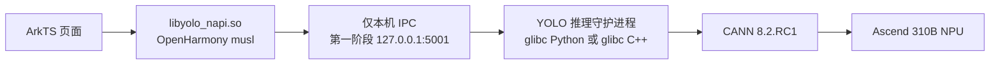

# 启智 01（Ascend 310B）显示驱动与 YOLOv5 NAPI 系统源码改造指导

> 用途：把本文件交给负责修改 OpenHarmony 系统源码和应用工程的 AI。  
> 目标系统：OpenHarmony 5.0.3 Release，启智 01 开发板（Ascend 310B），ARM64。  
> CANN 版本：8.2.RC1。  
> 本指导基于 2026-08-10 的板端实测结果编写。

## 1. 最终目标

请完成两个相互独立的改造，分成两个提交，不要混在同一个补丁中：

1. 永久修复 HDMI 误识别和黑屏问题。
2. 将 YOLOv5 推理能力正式集成进系统镜像，并让 ArkTS 像调用普通 NAPI 一样调用推理接口。

应用侧需要保留以下调用形式：

```ts
import * as yoloNapi from 'libyolo_napi.so'

const ok = yoloNapi.initModel(resourceManager, 'yolov5s_ascend310b.om', 0)
const result = await yoloNapi.infer(input)
yoloNapi.releaseModel()
```

“像普通 NAPI 一样使用”指 ArkTS 只面对 `libyolo_napi.so`，不要求页面代码调用 HTTP、Python 或外部服务器。板内是否使用独立推理进程，由 NAPI 内部隐藏。

## 2. 修改前必须阅读的文件

### 2.1 目标板资料

- `D:\WORK\E\2026OS\project3136859-388911\技术文档.pdf`
- `D:\WORK\E\2026OS\project3136859-388911\task1_transplantation\README.md`
- `D:\WORK\E\2026OS\project3136859-388911\task1_transplantation\device-soc-ascend-310B-hardware-display-src-display_device-drm_connector.cpp.patch`
- `D:\WORK\E\2026OS\project3136859-388911\task1_transplantation\device-board-ascend-310B-cfg-init.310B.yolov5.cfg.patch`
- `D:\WORK\E\2026OS\project3136859-388911\task1_transplantation\device-board-ascend-310B-cfg-BUILD.gn.patch`

### 2.2 当前 YOLOv5 应用

- `D:\WORK\DevEcoStudio\yolov5_app\entry\src\main\cpp\CMakeLists.txt`
- `D:\WORK\DevEcoStudio\yolov5_app\entry\src\main\cpp\yolo_napi.cpp`
- `D:\WORK\DevEcoStudio\yolov5_app\entry\src\main\cpp\yolo_engine.cpp`
- `D:\WORK\DevEcoStudio\yolov5_app\entry\src\main\cpp\ascend_cl_api.cpp`
- `D:\WORK\DevEcoStudio\yolov5_app\entry\src\main\ets\native\YoloNativeBridge.ets`
- `D:\WORK\DevEcoStudio\yolov5_app\tools\device\yolo_acl_service.py`
- `D:\WORK\DevEcoStudio\yolov5_app\tools\device\run_yolo_acl_service.sh`

### 2.3 参考应用

- `D:\WORK\DevEcoStudio\HarmonyInstrument_modify40\entry\src\main\cpp\CMakeLists.txt`
- `D:\WORK\DevEcoStudio\HarmonyInstrument_modify40\entry\src\main\cpp\bq_func.cpp`
- `D:\WORK\DevEcoStudio\HarmonyInstrument_modify40\entry\src\main\cpp\types\libentry\Index.d.ts`
- `D:\WORK\DevEcoStudio\HarmonyInstrument_modify40\entry\src\main\ets\pages\videoSurveillance\Index.ets`

不要直接复制参考应用的板级库或 CMake 链接参数。参考它的内容仅限于 ArkTS、NAPI、XComponent/native 模块的组织方式。

## 3. 已确认的根因和技术边界

### 3.1 HDMI 根因

板端实测有两个 DRM HDMI 连接器：

| 连接器 | status | EDID | 模式 |
| --- | --- | --- | --- |
| `card0-HDMI-A-1` | 被误报为 connected | 128 字节全零 | 1024x768、800x600、640x480 |
| `card0-HDMI-B-1` | connected | 256 字节有效 EDID | 包含 1920x1080@60Hz |

现有补丁在 `drm_connector.cpp` 中执行以下错误逻辑：只要连接器被报告为 connected 且 EDID 模式列表没有 1080p，就把 mode 0 强行替换成 1920x1080@60Hz。

该逻辑把 EDID 全零的 HDMI-A 当成真实显示器，导致 RenderService 发布两块物理屏，并反复出现：

```text
drmModeAtomicCommit failed -22 errno 22
```

运行时执行以下命令后，错误立即停止：

```sh
echo off > /sys/class/drm/card0-HDMI-A-1/status
```

所以永久修复必须进入系统源码；单纯在应用工程中不能正确修复显示驱动。启动脚本写 sysfs 只能作为临时回退方案。

另外，触摸屏必须使用稳定的独立电源。此前由开发板 USB 供电时，屏幕内部 USB Hub 和触摸控制器每约 5 秒掉线一次；换独立电源后掉线计数归零。这个供电问题不能通过源码修复。

### 3.2 推理运行时 ABI 根因

`HarmonyInstrument_modify40` 可以在应用进程内加载 `libentry.so`，因为它和所链接的相机、图形、OpenCV 库是 OpenHarmony NDK/musl ABI。

当前 `libyolo_napi.so` 同样是 OpenHarmony NDK/musl 模块：

```text
NEEDED libace_napi.z.so
NEEDED libhilog_ndk.z.so
NEEDED librawfile.z.so
NEEDED libc++_shared.so
NEEDED libc.so
```

板上 CANN 的 `libascendcl.so` 是 Linux glibc ABI：

```text
NEEDED librt.so.1
NEEDED libdl.so.2
NEEDED libstdc++.so.6
NEEDED libc.so.6
NEEDED ld-linux-aarch64.so.1
NEEDED libpthread.so.0
VERSION GLIBC_2.17
```

因此，当前 CANN 运行库不能安全地直接装入 appspawn 创建的 musl 应用进程。不要采用以下做法：

- 不要把 `libc.so.6` 链接或软链接到 OpenHarmony 的 `libc.so`。
- 不要把 glibc 和 musl 的分配器、线程、TLS 混入同一应用进程。
- 不要只通过增加 `LD_LIBRARY_PATH` 就宣称“直接 NAPI 已解决”。
- 不要把 CANN 的全部 `.so` 塞入 HAP 后绕过系统 linker namespace。

仅修改 OpenHarmony 系统源码，无法把现有 glibc CANN 二进制自动变成 musl 二进制。

## 4. 推荐的总体架构

采用“应用内 NAPI + 板内推理守护进程”的结构。应用侧体验与 `HarmonyInstrument_modify40` 相同，但 CANN 位于独立 glibc 进程中。



推荐分两阶段完成：

1. 必做：把当前已验证的 Python/glibc 服务正式打包进系统镜像，保留 127.0.0.1 二进制协议。先保证可重复构建、开机自动启动和 NAPI 端到端稳定。
2. 可选优化：使用厂商 aarch64-linux-gnu/glibc 工具链将服务改为 C++ 守护进程，或把 TCP 改为 Unix Domain Socket。不要在第一阶段同时更换语言、协议和启动方式。

## 5. 任务 A：永久修复显示驱动

### 5.1 修改目标

OpenHarmony 源码根目录记为 `$OHOS_ROOT`。主要目标文件：

```text
$OHOS_ROOT/device/soc/ascend/310B/hardware/display/src/display_device/drm_connector.cpp
```

同时更新项目中保存的补丁：

```text
D:\WORK\E\2026OS\project3136859-388911\task1_transplantation\device-soc-ascend-310B-hardware-display-src-display_device-drm_connector.cpp.patch
```

### 5.2 最小安全修复

删除现有补丁中“没有 1080p 就用手工时序替换 mode 0”的整个代码块。模式列表只能来自 DRM/EDID，不得默认注入显示器没有声明支持的模式。

模式选择逻辑应满足：

1. 清空旧模式和 preferred id。
2. 复制 `drmModeConnector::modes` 中内核实际提供的模式。
3. 优先选择带 `DRM_MODE_TYPE_PREFERRED` 的模式。
4. 如果没有 preferred 标记但模式列表非空，使用第一个内核模式作为回退。
5. 如果模式列表为空，不创建虚假的 1080p 模式。

伪代码：

```cpp
mModes.clear();
mPreferenceId = INVALID_MODE_ID;

for (int i = 0; i < connector.count_modes; ++i) {
    const drmModeModeInfo &mode = connector.modes[i];
    const int id = static_cast<int>(mModes.size());
    mModes.emplace(id, DrmMode { mode, id });
    if (mPreferenceId == INVALID_MODE_ID &&
        (mode.type & DRM_MODE_TYPE_PREFERRED) != 0) {
        mPreferenceId = id;
    }
}

if (mPreferenceId == INVALID_MODE_ID && !mModes.empty()) {
    mPreferenceId = mModes.begin()->first;
}
```

AI 必须根据真实源码的类型和成员变量调整以上伪代码，不能未经编译就原样粘贴。

### 5.3 推荐的完整修复：过滤无效 EDID 连接器

最小修复能消除非法 1080p 时序，但 HDMI-A 仍可能被内核误报为 connected。推荐在显示适配层增加 EDID 有效性判断，并避免把无效外接 HDMI 发布给 RenderService。

有效 EDID 至少满足：

1. blob 长度不小于 128 字节；
2. 前 8 字节为 `00 ff ff ff ff ff ff 00`；
3. 每个完整的 128 字节块校验和满足 `sum % 256 == 0`；
4. 至少有一个可用 DRM mode。

实现时通过 DRM connector 的 `EDID` blob property 读取原始 EDID，使用 `drmModeGetProperty()` 和 `drmModeGetPropertyBlob()`，并确保所有 property/blob 对象在退出路径释放。

处理策略：

- 对外接 HDMI：`connection == DRM_MODE_CONNECTED` 但 EDID 全零、头错误或校验失败时，不向 HDF/RenderService 发布为可用物理屏。
- 对有效 HDMI-B：保留 EDID 声明的 1920x1080@60Hz preferred 模式。
- 不要按 DRM connector 数字 ID 硬编码；ID 可能随内核或探测顺序变化。
- 如果产品确实需要支持无 EDID 显示器，必须使用显式产品配置开关和明确 connector/mode 白名单，默认关闭，不能再次恢复“所有 connected 端口强制 1080p”。

如果当前类拿不到 DRM fd，应沿调用链找到持有 fd 的设备对象，增加只读 helper；不要在显示库中读取固定的 `/sys/class/drm/card0-HDMI-A-1` 路径作为最终实现。

### 5.4 构建与烧录

按照技术文档使用 OpenHarmony 5.0.3 动态分支和 Ascend 310B 厂商源码。典型命令：

```sh
cd "$OHOS_ROOT"
./build.sh --product-name 310B --ccache
```

如果厂商封装要求一键脚本，则使用：

```sh
cd <Ascend310B 厂商源码目录>
sudo ./build.sh "$OHOS_ROOT"
```

镜像应生成在：

```text
$OHOS_ROOT/out/310B/packages/phone/images/
```

烧录前保留上一版可启动镜像。显示补丁和推理服务补丁必须能分别回退。

### 5.5 显示验收标准

屏幕使用独立稳定供电，冷启动和热插拔都要测试。

```sh
cat /sys/class/drm/card0-HDMI-A-1/status
cat /sys/class/drm/card0-HDMI-B-1/status
od -An -tx1 -N16 /sys/class/drm/card0-HDMI-A-1/edid
od -An -tx1 -N16 /sys/class/drm/card0-HDMI-B-1/edid
hidumper -s RenderService -a screen
hilog -x | grep -E 'drmModeAtomicCommit failed|Apply:309'
```

必须满足：

- RenderService 只发布真实有效的外接屏；如果只接一块屏，物理屏数量为 1。
- 有效屏使用 EDID 声明的 `1920x1080@60Hz`。
- 连续运行 5 分钟没有新的 `drmModeAtomicCommit failed -22`。
- 重启、拔插 HDMI、先开屏后开板、先开板后开屏四种顺序均能恢复显示。
- 不再依赖 `echo off > .../status` 才能正常显示。

## 6. 任务 B：将 YOLOv5 NAPI 正式集成进系统源码

### 6.1 应用侧接口保持不变

保留当前文件和接口：

```text
yolov5_app/entry/src/main/cpp/yolo_napi.cpp
yolov5_app/entry/src/main/cpp/yolo_engine.cpp
yolov5_app/entry/src/main/ets/native/YoloNativeBridge.ets
```

必须继续提供：

- `initModel(resourceManager, rawfileName, deviceId?) -> boolean`
- `getModelInfo() -> YoloModelInfo`
- `infer(Float32Array) -> Promise<NativeInferenceResult>`
- `releaseModel() -> void`

推理必须使用 `napi_async_work` 或等效异步机制，不能阻塞 ArkUI 主线程。

### 6.2 禁用不可靠的直接 CANN 回退

当前 `YoloEngine::Initialize()` 在板内服务连接失败后会尝试 `dlopen(libascendcl.so)`。对这块板的现有 CANN/glibc 包，这条回退路径不可靠且容易误导诊断。

要求：

- 默认构建仅启用板内服务模式。
- 如果保留直接模式代码，必须用显式编译开关隔离，例如 `YOLO_ENABLE_DIRECT_ACL=0`。
- 服务不可用时返回清晰错误，例如 `CANN inference service unavailable`，不得让应用崩溃。
- `runtimePath` 应明确返回 `service://127.0.0.1:5001/...` 或后续 UDS 地址。

### 6.3 将服务文件纳入系统镜像

在 OpenHarmony 源码中创建可维护的目录，例如：

```text
device/board/ascend/310B/yolo_napi/
├── BUILD.gn
├── yolo_acl_service.py
└── README.md

device/board/ascend/310B/cfg/
├── run_yolo_acl_service.sh
├── init.310B.yolov5.cfg
└── BUILD.gn
```

第一阶段直接复用并审查：

```text
D:\WORK\DevEcoStudio\yolov5_app\tools\device\yolo_acl_service.py
D:\WORK\DevEcoStudio\yolov5_app\tools\device\run_yolo_acl_service.sh
```

GN 集成要求：

1. 用项目现有的 `ohos_prebuilt_etc`/预编译文件模板将 Python 服务和启动脚本安装进 system/vendor 镜像。
2. 更新 `device/board/ascend/310B/cfg/BUILD.gn` 的 `init_configs` 依赖。
3. 更新 `device/board/ascend/310B/BUILD.gn`，确保 yolo_napi 文件组被产品构建引用。
4. 更新 `task1_transplantation` 中对应的补丁文件，不能只在已烧录设备的 `/vendor/etc` 手工修改。
5. 运行时模型和可写缓存放到 `/data` 或现有 `/cann-install/yolov5_napi`，不要写只读 system/vendor 分区。

### 6.4 init 服务要求

在 `init.310B.yolov5.cfg` 中增加独立服务 `yolo_acl_service`。可沿用当前经过实测的基本配置：

```json
{
  "name": "yolo_acl_service",
  "start-mode": "boot",
  "path": ["/system/bin/sh", "/vendor/etc/run_yolo_acl_service.sh"],
  "sandbox": 0,
  "uid": "HwHiAiUser",
  "gid": ["HwHiAiUser", "HwBaseUser", "HwDmUser"],
  "once": 0,
  "disabled": 0
}
```

但启动脚本必须改进为：

1. 等待 `/dev/davinci0`、`/dev/davinci_manager`、CANN 环境脚本和 Python 可执行文件存在。
2. 设置 `ASCEND_HOME_PATH`、`ASCEND_OPP_PATH`、`PYTHONPATH`、`LD_LIBRARY_PATH` 等 CANN 环境。
3. `LD_LIBRARY_PATH` 包含当前 glibc 辅助库路径 `/libaarch64/aarch64-linux-gnu`。
4. 加入有上限的等待日志和失败原因，不要无声无限循环。
5. 服务异常退出后允许 init 重启，但服务内部要保证模型和 NPU 资源正确清理。

当前服务在驱动节点尚未准备好时导入 `ais_bench`，启动日志会出现一次设备管理器打开失败。建议把 `ais_bench`/`InferSession` 改为首次 INIT 请求时延迟导入，并在导入前检查设备节点。

### 6.5 板内协议与安全要求

第一阶段保留已经跑通的 `127.0.0.1:5001` 二进制协议，避免同时引入过多变量。

必须保持：

- 只监听 `127.0.0.1`，禁止监听 `0.0.0.0`。
- 固定 magic、version、command 和 payload length。
- 限制请求/响应最大长度，当前上限 128 MiB。
- INIT 校验 OM 文件长度和哈希。
- INFER 校验输入字节数与模型输入完全一致。
- 模型对象由互斥锁保护，同一 NPU context 不被并发破坏。
- 支持 PING、INFO、INIT、INFER、RELEASE；客户端断开不能杀死服务。
- 日志不得打印完整模型数据、张量内容或用户图片。

后续可把 TCP 替换为 Unix Domain Socket。该优化需要同时完成 socket 权限、应用沙箱访问和 SELinux/HDF 策略验证，不能只改路径。

### 6.6 可选：改为 glibc C++ 推理守护进程

若目标是去掉 Python，可使用 Ascend 厂商提供的 aarch64-linux-gnu/glibc 工具链和 CANN 头文件，在 OpenHarmony 构建系统之外生成 `yolo_acl_daemon`，再以 prebuilt executable 形式打入镜像。

注意：

- 守护进程必须是 glibc 进程，不能用 OpenHarmony NDK/musl 编译后再直接链接现有 CANN。
- C++ 服务继续复用同一个板内协议，NAPI 和 ArkTS 不需要变化。
- 先通过独立命令行测试 `aclInit -> aclrtSetDevice -> aclmdlLoadFromFile/Memory -> aclmdlExecute -> release`，再替换 Python 服务。
- 替换前后必须使用同一模型、同一输入，逐元素比较输出容差。

### 6.7 真正“同一进程直接 NAPI”的准入条件

只有厂商提供完整的 OpenHarmony/musl CANN 运行库后，才能考虑把 CANN 放入 `libyolo_napi.so` 所在进程。

准入检查：

```sh
llvm-readelf -d libascendcl.so
llvm-readelf -V libascendcl.so
```

必须同时满足：

- 不依赖 `libc.so.6`、`ld-linux-aarch64.so.1`、`libpthread.so.0` 等 glibc ABI。
- 整个依赖树均有 OpenHarmony/musl 兼容版本。
- 系统 linker namespace 明确允许应用加载这些库。
- 厂商确认在 appspawn/ArkTS 进程内初始化 CANN 的用法受到支持。
- 100 次初始化/推理/释放和应用前后台切换均无崩溃。

当前板上的 CANN 8.2.RC1 不满足这些条件，所以“修改几处系统源码后把现有 libascendcl 直接链接进 NAPI”不是可接受方案。

## 7. 推理验收标准

### 7.1 开机服务

```sh
ps -ef | grep yolo_acl_service
netstat -lntp | grep 127.0.0.1:5001
ls -l /dev/davinci0 /dev/davinci_manager
tail -n 100 /data/yolov5_napi/yolo_acl_service.log
```

必须满足：

- 冷启动后无需手工执行环境脚本，服务自动启动。
- 只监听本机地址。
- 服务重启后 NAPI 能返回可理解的暂时不可用错误，并能在服务恢复后重新初始化。
- 启动日志没有持续刷新的驱动错误。

### 7.2 NAPI 端到端

当前模型的已验证基线：

```text
输入：1 x 3 x 640 x 640 float32 = 4,915,200 字节
输出：标准 YOLOv5 原始输出约 8,568,000 字节
NPU 推理时间：约 19 ms（仅作为当前板实测参考，不作为硬编码阈值）
```

至少完成：

1. HAP 安装后调用 `initModel()` 成功。
2. `getModelInfo()` 返回正确 device id、输入/输出字节数和 service runtime path。
3. 连续推理 100 次，无 native crash、无 NPU context 泄漏、无明显持续内存增长。
4. 每次推理使用异步 Promise，ArkUI 页面保持响应。
5. 应用切到后台再回前台，能够继续推理或明确重新初始化。
6. 杀掉服务验证自动拉起；应用不得随服务一起崩溃。
7. 重启开发板后无需 hdc 手工启动即可完成一次推理。
8. 对同一输入，服务化 NAPI 输出与设备端 `ais_bench`/CLI 输出一致。

## 8. 推荐实施顺序

1. 记录 OpenHarmony 源码分支、commit 和工作区状态。
2. 单独修改显示驱动，编译、烧录并完成显示验收。
3. 在第二个提交中把现有 Python/glibc 推理服务纳入系统镜像。
4. 构建并安装 `yolov5_app`，完成 NAPI 端到端验收。
5. 更新 `task1_transplantation` 中所有受影响补丁和 README。
6. 只有在基线全部通过后，才考虑 UDS 或 glibc C++ daemon 优化。

每一步都应给出：

- 修改文件列表；
- 关键 diff；
- 实际执行的构建命令；
- 构建结果；
- 板端验证命令和原始结果；
- 回退方法。

## 9. 禁止事项

- 不要修改或覆盖与本任务无关的用户改动。
- 不要用 `git reset --hard`、整仓覆盖或不可恢复的清理命令。
- 不要把 HDMI-A/B 名称硬编码为永久产品判断，除非厂商硬件定义明确且有注释和测试。
- 不要继续默认强制注入 1080p。
- 不要宣称换电源问题可以由驱动补丁解决。
- 不要在 musl NAPI 进程中强行装入当前 glibc CANN。
- 不要为了“看起来是直接 NAPI”而隐藏服务失败或吞掉错误。
- 不要把推理服务开放到局域网。

## 10. 完成定义

只有以下条件全部满足，才可以向用户报告“修改完成”：

- 新系统镜像能正常启动和显示桌面。
- 有效 HDMI 屏幕为 1920x1080@60Hz，5 分钟无 atomic commit 错误。
- 触摸屏使用独立供电且 USB 不再周期掉线。
- 系统镜像中包含推理服务和启动配置，不依赖手工 hdc 部署。
- ArkTS 只通过 `libyolo_napi.so` 调用推理。
- 冷启动后 NAPI 至少成功完成 1 次真实 NPU 推理。
- 100 次循环推理和服务重启测试通过。
- 补丁、README、构建步骤和回退步骤均已同步更新。
